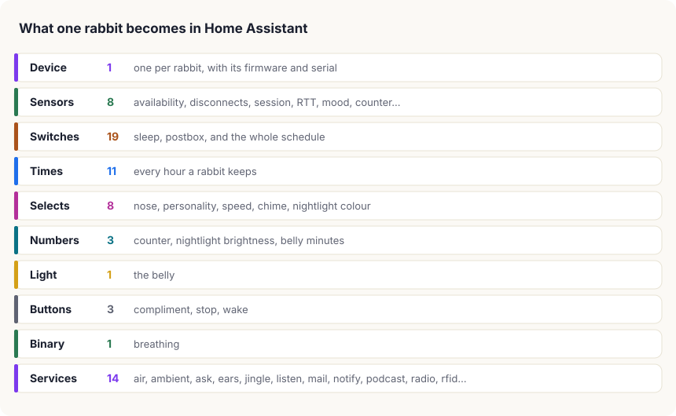
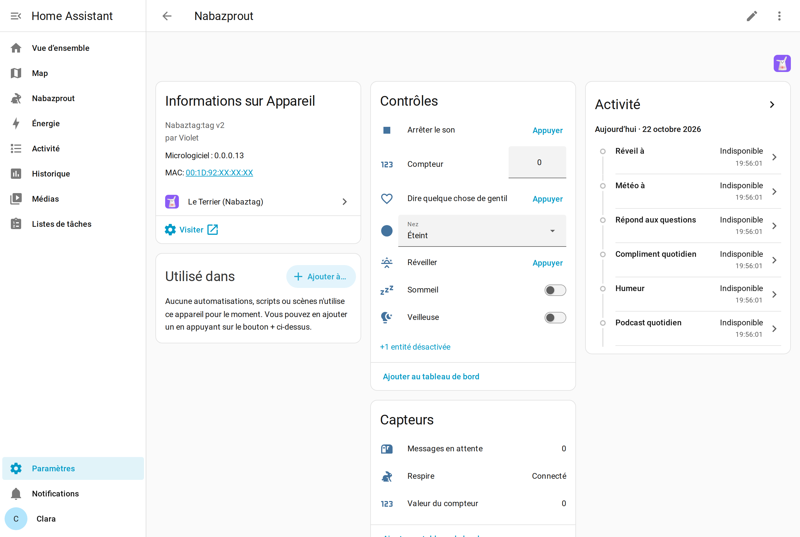
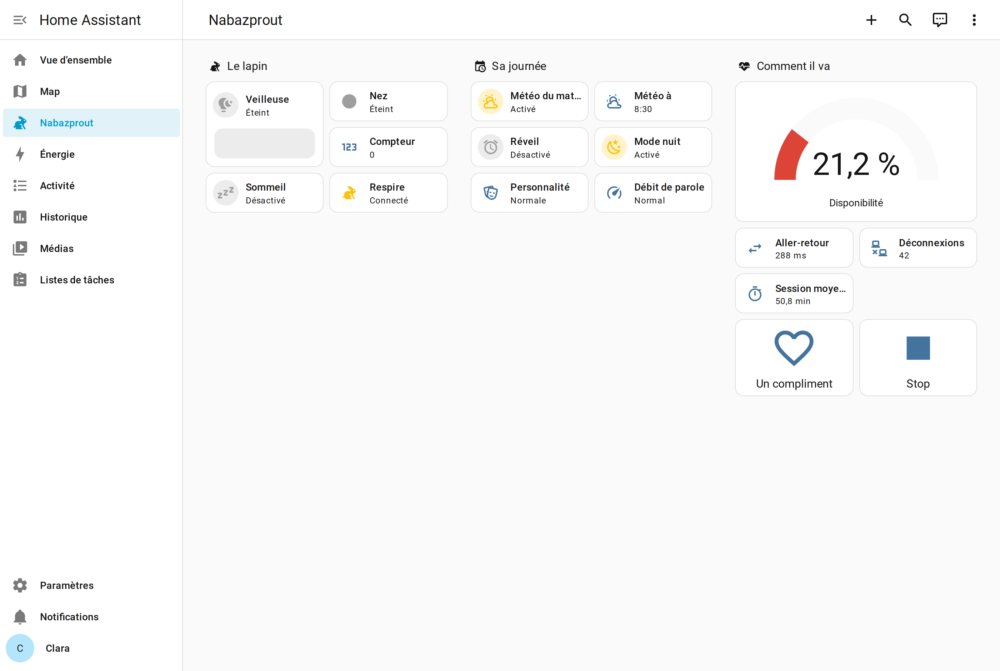
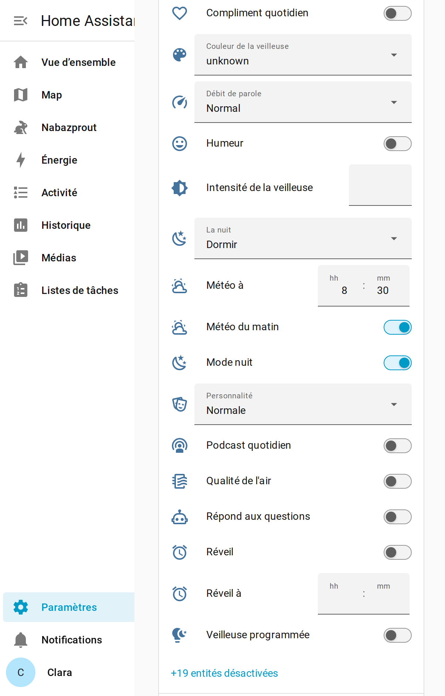
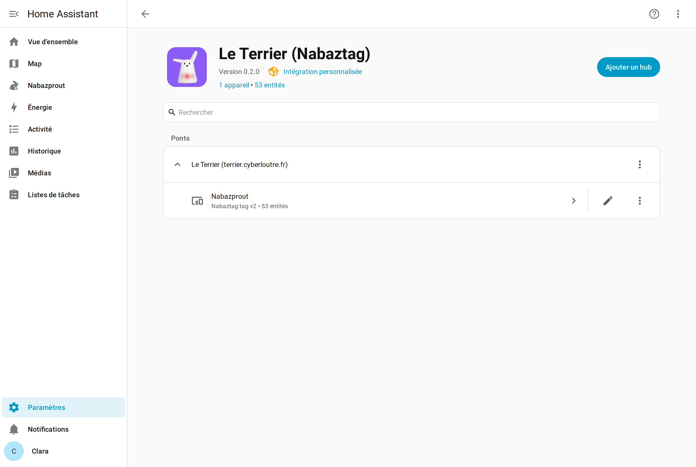
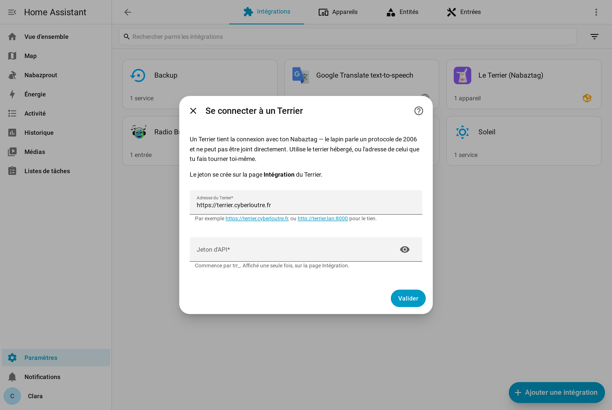

<p align="center">
  
  &nbsp;&nbsp;&nbsp;
  
</p>

<h1 align="center">Le&nbsp;Terrier&nbsp;&nbsp;×&nbsp;&nbsp;Home&nbsp;Assistant</h1>

<p align="center">
  <strong>A 2006 Wi-Fi rabbit, as proper Home Assistant devices.</strong><br>
  <sub>Entities, not REST calls. Works against the hosted warren or one you run yourself.</sub>
</p>

<p align="center">
  <a href="https://github.com/hacs/integration"></a>
  <a href="https://github.com/ClaraVnk/terrier-ha/releases"></a>
  <a href="https://github.com/ClaraVnk/terrier-ha/actions"></a>
  <a href="LICENSE"></a>
  
  
  
  
</p>

<p align="center">
  
  
  
  
  
  
  
  <br><sub>every capability above verified against a real Nabaztag:tag&nbsp;v2 🐰</sub>
</p>

---

The **Nabaztag** is a Wi-Fi rabbit from 2005–2006 by Violet. It has ears that
turn, five belly LEDs, a nose, a speaker and a microphone, and it speaks a
protocol that nobody has run a server for since the company died around 2011.

**[Le Terrier](https://terrier.cyberloutre.fr)** is that server, brought back.
This integration is how Home Assistant talks to it.

> **Why not talk to the rabbit directly?** Because you cannot. The hardware
> speaks plain HTTP and XMPP from 2006 — no TLS, ever — and it expects a
> server to hold an open XMPP session and answer `violet:iq:sources` before it
> will accept a single command. A Terrier holds that session. This integration
> talks to the Terrier.

### ✨ What you get

- 🐰 **One device per rabbit**, named whatever you called it, with its firmware
  version and serial where Home Assistant expects them.
- 💡 **The belly as a `light`** — on, off, colour, brightness. It snaps to the
  seven colours the hardware actually has and *tells you which one it used*,
  rather than pretending to be an RGB bulb and quietly lying.
- 🔴 **The nose as a `select`** — off, one blink, two blinks. That really is
  all three states the hardware can tell apart, and the reason why is in the
  [notes](#why-the-nose-has-three-states) below.
- 🔢 **A counter you can point at anything** — parcels in transit, open
  tickets, days until the holidays. On the hardware it *is* the nose.
- 😴 **Sleep as a `switch`** — real hardware sleep: lights out, ears down,
  pushed commands refused. Not a software mute.
- 📊 **Diagnostics that explain a flaky rabbit** — availability, disconnects,
  average session length, round-trip time, packet loss. A 2006 802.11b radio
  on a modern access point drops connections, and these turn *"it stopped
  working"* into *"it lost the server eleven times yesterday"*.
- 🔔 **`terrier.notify`** — belly, nose, counter, jingle and a spoken sentence
  in **one** call. A parcel arriving should not need five service calls.
- 📻 **Radio, podcasts, jingles, ear choreography, and mail to other rabbits**,
  each as a service with a proper UI form.
- ⏰ **Its whole schedule, as entities** — the morning weather, the alarm, the
  hourly chime, night mode, the nightlight and the daily podcast, each a
  `switch` with the `time` that goes with it. This is the half an automation
  most wants to reach, and it used to need a browser.
- 🎚️ **Its settings, as `select`s and `number`s** — personality, speaking
  speed, chime style, nightlight colour and brightness. The options are the
  warren's own, so a colour the firmware has never heard of cannot be chosen.
- 🤖 **`terrier.ask`** — put a question to the rabbit's own model, with your
  own key. It answers out loud, and the answer comes back to the automation.
- 🎙️ **`terrier.listen`** — push-to-talk. The rabbit records one sentence,
  the warren transcribes it and it answers aloud; the words come back so an
  automation can act on them. Nothing listens on its own, ever.
- 🏷️ **`terrier.rfid_bind`** — tie a tag to a phrase, a station, the weather
  or a webhook.
- ⚙️ **`terrier.set_config`** — the long tail: wake word, voice, coordinates,
  feed URL, model name. Applied all at once or not at all.

> **API keys are the one thing this cannot set.** The warren refuses to write
> them over HTTP on purpose: Home Assistant would have to hold one to send
> it, and a key pasted into an automation is a key in a YAML backup, in a
> snapshot, and in whatever syncs that snapshot. They stay on the warren's
> own settings page.

### 🗺️ What one rabbit becomes

<p align="center">
  
</p>

<sub>Generated from <code>settings.py</code> and <code>icons.json</code>, so it cannot describe a version that no longer exists. Most of the schedule entities ship disabled — enable the ones you want from the device page.</sub>

<p align="center">
  
  
</p>
<p align="center">
  
  
  
</p>

<sub>Un vrai Home Assistant, un vrai Nabaztag:tag&nbsp;v2 de 2006, de vraies valeurs — 21&nbsp;% de disponibilité et 42 déconnexions, c'est ce que vaut une radio&nbsp;802.11b sur un point d'accès moderne. Seule l'adresse MAC a été masquée.</sub>

### 📦 Install

<a href="https://my.home-assistant.io/redirect/hacs_repository/?owner=ClaraVnk&repository=terrier-ha&category=integration"></a>
&nbsp;
<a href="https://my.home-assistant.io/redirect/config_flow_start/?domain=terrier"></a>

**Through HACS** (recommended)

1. HACS → ⋮ → **Custom repositories**
2. Repository: `https://github.com/ClaraVnk/terrier-ha` — Category: **Integration**
3. Install **Le Terrier (Nabaztag)**, then restart Home Assistant.
4. **Settings → Devices & services → Add integration → Le Terrier**

**By hand**

Copy `custom_components/terrier/` into your `config/custom_components/` and
restart.

### 🔑 Setting it up

You need two things, and the form asks for exactly those two:

| | |
|---|---|
| **Terrier address** | `https://terrier.cyberloutre.fr`, or your own instance |
| **API token** | From the Terrier's **Integration** page. Starts with `trr_`, shown once |

The token is checked before the entry is created — an integration that sets up
cleanly and then fails forever is worse than one that refuses at the door. If
the token is later revoked, Home Assistant asks for a new one rather than
going quiet.

### 🤖 Examples

Something arrived:

```yaml
action: terrier.notify
target:
  device_id: !input rabbit
data:
  colour: blue
  jingle: ears
  counter: 1
  text: "Un colis est arrivé."
```

Wake the house with the rabbit, not a buzzer:

```yaml
action: terrier.ears
target: { device_id: !input rabbit }
data: { left: 0, right: 0 }
```

Keep a parcel count on the nose, from anything:

```yaml
action: number.set_value
target: { entity_id: number.nabazprout_counter }
data: { value: "{{ states('sensor.parcels_in_transit') | int }}" }
```

> **No automation needed at all?** The Terrier also mints a plain URL that sets
> the counter — for anything that can call a URL but cannot send an
> authorization header. It is on the rabbit's page.

### 📝 Notes

#### Why the nose has three states

The bytecode lights the nose violet from a count of waiting messages: one blink
at one, two blinks at two and above (`info.mtl:173`). The "nose" and the
"unread counter" are **one register on the hardware**, not two features — which
is also why setting the counter changes the nose, and why there is no digit
display anywhere on a Nabaztag.

#### Why the belly light has seven colours

Because the rabbit does. Exposing a full colour wheel would let Home Assistant
ask for a teal the hardware cannot produce; this snaps to the nearest real
colour and reports back what it actually used.

#### Why podcasts sometimes refuse an episode

The audio decoder is a **VS1003**: MP3, WMA, MIDI, WAV — and *not* AAC. Several
podcasts, Radio France among them, now serve `audio/mp4` exclusively. The
Terrier greys those out rather than streaming silence at you.

#### Availability

An entity stays **available** when the rabbit is unplugged. Its mood, its
counter and its schedule are still worth showing, and the diagnostics that
explain *why* it went away are exactly what you want at that moment. The
**Breathing** sensor is what tells you whether it is there.

### 🧩 The rest of the project

| | |
|---|---|
| [**ClaraVnk/nabaztag**](https://github.com/ClaraVnk/nabaztag) | The Home Assistant **add-on** (a fully local Violet server) and **Naboot**, the signed custom firmware |
| [**Le Terrier**](https://terrier.cyberloutre.fr) | The hosted warren — weather, alarm, air quality, podcasts, mail between rabbits |

Running your own Terrier keeps everything on your network and still gives you
this integration: it is the same API either way.

### 🤝 Contributing

Issues and pull requests are welcome, especially from anybody with a rabbit
and a network that misbehaves — that is where the interesting bugs live. If
you are reporting one, the **diagnostics** sensors are the useful thing to
include.

### 📄 Licence

Apache 2.0. Nabaztag and Violet are trademarks of their respective owners; this
project is not affiliated with them.
